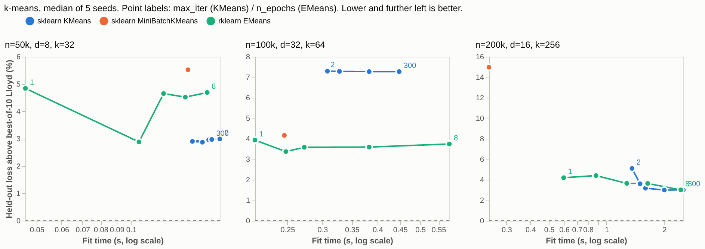
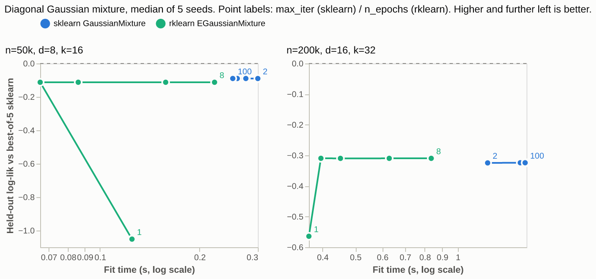

# e-means benchmarks

Results for `rklearn.cluster.EMeans` and `rklearn.mixture.EGaussianMixture`,
produced by [`notebooks/benchmark_emeans.py`](notebooks/benchmark_emeans.py).
Reproduce with (PNG export needs `vl-convert-python`):

```bash
uv run notebooks/benchmark_emeans.py
```

## Method

- Synthetic Gaussian mixtures with unequal cluster sizes and spreads. Each config
  uses one fixed dataset, split 80/20 into train and held-out sets.
- Every model is fit with 5 `random_state` values. Tables and charts show the
  median; the tables also show the min and max over the 5 seeds.
- Quality is measured on the held-out split against one fixed reference per
  dataset: the best of 10 sklearn `KMeans` restarts (`n_init=10`), or the best of
  5 sklearn `GaussianMixture` restarts for the mixtures.
- Wall-clock fit times on a 4-core Linux container. rklearn runs with `n_jobs=-1`;
  sklearn uses its defaults (also multithreaded).

Why the fixed reference: on these datasets a single k-means run's local optimum
moves the loss by 10-15% from one seed to the next, for every method. An earlier
version of this page compared single runs and reported EMeans as 11% worse on the
50k dataset; that was seeding luck, not the algorithm.

## k-means: fit time vs. quality



Each line sweeps a method's budget: `max_iter` in {2, 5, 10, 25, 300} for sklearn
`KMeans` and `n_epochs` in {1, 2, 3, 5, 8} for `EMeans`. The point labels mark the
ends of each sweep. sklearn's line is short because Lloyd usually converges within
a handful of iterations, so `max_iter` past that changes nothing.

At default settings (`max_iter=300`, `n_epochs=3`). Loss is the percentage above the
best-of-10 reference; lower is better.

| data | model | fit time (s) | median loss | min .. max over seeds | speedup vs sklearn |
|---|---|---|---|---|---|
| 50k x 8, k=32 | sklearn KMeans | 0.181 | +2.97% | +0.41 .. +14.91 | 1.0x |
| | rklearn EMeans | 0.127 | +4.65% | +2.53 .. +14.61 | 1.4x |
| | rklearn EMeans (revival) | 0.125 | +4.71% | +2.48 .. +14.64 | 1.4x |
| | sklearn MiniBatchKMeans | 0.152 | +5.52% | -1.23 .. +13.03 | 1.2x |
| | rklearn KMeans | 0.762 | +6.75% | +4.19 .. +12.34 | 0.2x |
| 100k x 32, k=64 | sklearn KMeans | 0.448 | +7.27% | +2.08 .. +8.62 | 1.0x |
| | rklearn EMeans | 0.273 | +3.58% | -2.24 .. +8.98 | 1.6x |
| | rklearn EMeans (revival) | 0.320 | +3.58% | +0.75 .. +14.78 | 1.4x |
| | sklearn MiniBatchKMeans | 0.246 | +4.16% | +3.76 .. +12.24 | 1.8x |
| | rklearn KMeans | 2.222 | +7.17% | +0.62 .. +10.43 | 0.2x |
| 200k x 16, k=256 | sklearn KMeans | 2.516 | +3.00% | +0.01 .. +4.30 | 1.0x |
| | rklearn EMeans | 1.274 | +3.64% | +0.69 .. +5.66 | 2.0x |
| | rklearn EMeans (revival) | 1.350 | +5.55% | +4.52 .. +6.99 | 1.9x |
| | sklearn MiniBatchKMeans | 0.243 | +14.97% | +11.43 .. +19.47 | 10.4x |
| | rklearn KMeans | 15.466 | +2.15% | +1.77 .. +3.20 | 0.2x |

Takeaways:

- **EMeans is 1.4-2x faster than sklearn `KMeans` with no clear quality cost.**
  Its median loss is 1.7 and 0.6 points worse than sklearn on two datasets and
  3.7 points better on the third, all inside the seed-to-seed spread.
- **`n_epochs=1` trades a little quality for speed.** It is 2.1-4.2x faster than
  sklearn here. It is 1.2-1.9 points worse than sklearn on two datasets and 3.3
  points better on the third.
- `MiniBatchKMeans` is the fastest option but falls well behind at larger k
  (+15% at k=256).
- Revival did not help on any dataset and hurt at k=256.
- The Rust Lloyd `KMeans` is 4-6x slower than sklearn at these sizes. That is a
  separate issue from this PR.
- The speedups are smaller than the 2-24x reported by the paper and the
  [sacredvoid/emeans](https://github.com/sacredvoid/emeans) port. They used larger
  n and k and more cores; the gap should grow with n and k.

## Batch size and alpha

`EMeans(n_clusters=64)` on the 100k x 32 dataset, median of 5 seeds. `None` means
the paper's fitted law picks the value.

| batch_size | alpha | batch used | alpha used | median loss |
|---|---|---|---|---|
| None | None | 4096 | 1.000 | +3.58% |
| None | 0.05 | 4096 | 0.050 | +4.12% |
| None | 0.2 | 4096 | 0.200 | +3.71% |
| None | 0.8 | 4096 | 0.800 | +3.72% |
| 256 | None | 256 | 0.099 | +7.52% |
| 256 | 0.05 | 256 | 0.050 | +7.54% |
| 256 | 0.2 | 256 | 0.200 | +7.16% |
| 256 | 0.8 | 256 | 0.800 | +3.17% |
| 1024 | None | 1024 | 0.344 | +3.91% |
| 1024 | 0.05 | 1024 | 0.050 | +3.91% |
| 1024 | 0.2 | 1024 | 0.200 | +3.92% |
| 1024 | 0.8 | 1024 | 0.800 | +3.46% |
| 4096 | None | 4096 | 1.000 | +3.58% |
| 4096 | 0.05 | 4096 | 0.050 | +4.12% |
| 4096 | 0.2 | 4096 | 0.200 | +3.71% |
| 4096 | 0.8 | 4096 | 0.800 | +3.72% |

The defaults are fine. With batches of 1024 or more, alpha hardly matters. With
small batches a low alpha hurts: at `batch_size=256` the step law picks 0.099 and
loses 4 points to `alpha=0.8`. If you set a small `batch_size` by hand, also set a
larger `alpha`.

## Gaussian mixtures: fit time vs. quality



sklearn `GaussianMixture(covariance_type="diag")` is swept over `max_iter` in
{2, 5, 10, 25, 100} and `EGaussianMixture` over `n_epochs` in {1, 2, 3, 5, 8}.
The y-axis is held-out mean log-likelihood per sample minus that of the best of 5
sklearn restarts; higher is better.

At default settings (`max_iter=100`, `n_epochs=3`):

| data | model | fit time (s) | median log-lik gap | min .. max over seeds | speedup vs sklearn |
|---|---|---|---|---|---|
| 50k x 8, k=16 | sklearn GaussianMixture | 0.252 | -0.090 | -0.091 .. +0.088 | 1.0x |
| | rklearn EGaussianMixture | 0.086 | -0.112 | -0.628 .. -0.032 | 2.9x |
| | rklearn EGaussianMixture (revival) | 0.134 | -0.112 | -0.628 .. -0.032 | 1.9x |
| 200k x 16, k=32 | sklearn GaussianMixture | 1.579 | -0.324 | -0.618 .. -0.188 | 1.0x |
| | rklearn EGaussianMixture | 0.452 | -0.310 | -0.989 .. -0.001 | 3.5x |
| | rklearn EGaussianMixture (revival) | 0.500 | -0.026 | -0.581 .. +0.142 | 3.2x |

Takeaways:

- **EGaussianMixture is about 3x faster than sklearn with similar quality.** Its
  median log-likelihood is 0.02 lower on the small dataset and 0.01 higher on the
  larger one.
- Its worst seed is worse than sklearn's worst seed (down to -0.99), so the
  spread between runs is wider.
- **Do not use `n_epochs=1` for mixtures.** One pass is clearly worse (-1.05 and
  -0.56); quality levels off from 2 epochs.
- Revival helped on the larger mixture (-0.03 vs -0.31), unlike k-means.
- Only diagonal covariances are supported.
